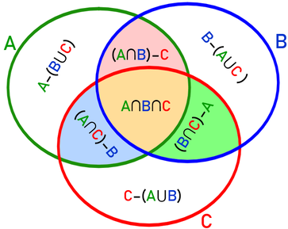

# Insiemi

# Insiemi

### Il concetto di insieme

Gli insiemi sono una collezione ben definita di oggetti. Un insieme è caratterizzato dal suo contenuto, ovvero dagli elementi che gli appartengono. Formalizziamo il concetto di appartenenza.

### Caratterizzazione di un insieme

<aside>

**Appartenenza**
Se T è un insieme, l’espressione $x \in T$ si legge: “x appartiene all’insieme T” oppure “x è un elemento di T”.

</aside>

<aside>

**Non Appartenenza**
Scriveremo invece $x \notin T$ per negare l’espressione precedente, cioè affermare che x non appartiene all’insieme T.

</aside>

### Assioma di estensionalità

Dal momento che un insieme è univocamente caratterizzato dal suo
contenuto, due insiemi che contengono gli stessi elementi, sono lo
stesso insieme. Abbiamo, quindi, una prima proprietà fondamentale
che viene anche denominata "Assioma di Estensionalità":

<aside>

**Uguaglianza tra insiemi**
Due insiemi A e B sono uguali se hanno gli stessi elementi. In simboli

$A = B \iff (\forall x) (x \in A \iff x \in B)$

</aside>

### Descrizione di un insieme

Per descrivere un insieme sarà sufficiente elencarne gli elementi. Per convenzione vengono indicati tramite partentesi graffe. Ad esempio, un insieme $\{1,2,3\}$ indica l’insieme i cui elementi sono appunto i numeri 1, 2, 3.

<aside>

**Singoletto**
La notazione $\{a\}$ indica l’insieme costituito solo da un elemento $a$, detto singoletto.

</aside>

<aside>

Insieme Vuoto
Con il simbolo $\emptyset$ indicheremo un insieme speciale, detto insieme vuoto, che è l’insieme che non contiene alcun elemento.

</aside>

### Definizione di un insieme

Dalla definizione di uguaglianza, deduciamo immediatamente che gli insiemi $A = \{1,2,3\}$ e $B = \{2,3,1,2,3\}$ sono uguali perché contengono gli stessi elementi. Per lo stesso motivo sono uguali anche gli insiemi $A = \{1,2,3\}$ e $B = \{3,2,1\}$.
Quindi da questo capiamo che ogni insieme è caratterizzato dal fatto che i suoi elementi appaiono una sola volta, e non importa in quale ordine sono elencati.

Possiamo specificare un insieme e la proprietà che caratterizza i suoi elementi in questo modo:

Se P è una proprietà ben definita, possiamo allora definire l’insieme 

$$
\{x : \text{la proprietà P è vera per P}\} \equiv \{x:P(x)\}
$$

Questo vuol dire: ”Prendiamo tutti i valori di x per cui la frase P(x) è vera, e li mettiamo in un insieme.”

Cosa vuol dire che P è una proprietà ben definita? Vuol dire che
per ogni valore di x, P(x) può assumere sempre solo i 2 valori vero o falso

Esempi:

Se scrivo:

> $P(x)$: "x è maggiore di 5"
> 
- Allora:
    - $P(3)$ è **falsa** (perché 3 non è maggiore di 5)
    - $P(7)$ è **vera** (perché 7 è maggiore di 5)

Altro esempio:
Supponi che:

- $P(x)$ = "x è un numero pari"
- Allora l'insieme ${x : P(x)}$  significa:

*“L’insieme di tutti gli x **pari**”*

Quindi: $\{x \in \N : \text{x è pari}\} = \{0, 2, 4, 6, 8, ...\}$

Esempio di NON insieme:
Supponiamo P sia la proprietà di essere “alti”, allora $\{x : P(x)\}$ non è un insieme.

### Cardinalità

Ad ogni insieme si può associare la caratterizzazione della quantità degli elementi che gli appartengono.

<aside>

**Cardinalità**
Dato un insieme A, il numero di elementi che lo costituisce è denominato cardinalità dell’insieme ed è denotata con  $|A|$. Se $|A|$  è un numero intero l’insieme si dice finito, altrimenti infinito.

</aside>

Esempio:

- La cardinalità dell’insieme vuoto è quindi zero, $|\emptyset| = 0$, mentre $|\{1,2,3\}| = 3$ e $|\{a\}| = 1$.
- La cardinalità dell’insieme costituito dai numeri pari è invece infinita, $|\{x : x \space \text{è un numero pari}\}|= +\infin$

### Relazione di Inclusione

Se abbiamo due insiemi $A$ e $B$ e tutti gli elementi di $A$ sono anche
elementi di $B$ allora diciamo che $A$ è incluso in $B$, ovvero che $A$ è un
sottoinsieme di $B$.

<aside>

**Inclusione**
$A$ è un sottoinsieme di $B$, denotato con $A \sube B$ se:

$$
A \sube B \iff (\forall x) (x \in A \implies x \in B)
$$

</aside>

Si legge: A è contenuto in B se e solo se, per ogni x, se x appartiene ad A allora x appartiene anche a B.

Notiamo che la relazione $A \sube B$ è verificata nel caso in cui $A = B$.

Per esprimere il fatto che $A \sube B$ ma $A$ è diverso da $B$, cioè esistono elementi di $B$ che non sono elementi di A, scriviamo $A \sub B$ o equivalentemente $B \sub A$. In questo caso diciamo che $A$ è un sottoinsieme proprio di $B$, ovvero $A$ è propriamente contenuto in $B$.

Possiamo specificare un sottoinsieme di un dato insieme elencandone gli elementi, quando possibile, oppure utilizzare una proprietà ben definita. Più in dettaglio, supponiamo che $T$ sia un insieme e che $P(x)$ sia una proprietà che ha senso per gli elementi di $T$. Scriviamo allora $\{x : x \in T \space \text{e} \space P(x)\}$ per indicare il sottoinsieme di $T$ formato dagli elementi per cui $P(x)$ è vera.

Esempio:

Supponiamo $T$ sia l’insieme di tutti i numeri interi positivi da 1 a 100, ovvero

$$
T = \{1,2,3,4,...,98,99,100\}
$$

e supponiamo che la proprietà $P(x)$ sia quella di essere un multiplo di 10. Allora

$$
\{x : x \in T \space \text{e} \space P(x)\} = \\ \{10,20,30,40,50,60,70,80,90,100\}
$$

### Insiemi discreti

<aside>

**Insieme discreto**

Un insieme $A$ si dice discreto se è possibile ordinare i suoi elementi in maniera tale che tra un qualunque elemento ed il successivo nell’ordinamento dato, non vi sono altri elementi dell’insieme. Quindi, è un insieme composto da elementi "isolati".

</aside>

Ogni insieme finito è discreto. In particolare, anche l’insieme vuoto $\emptyset$ è discreto.

Ricordiamo che:

$$
\mathbb{N} = \left\{ 0,1,2,3,4,...\right\}\\\mathbb{Z} = \left\{ ..., -4, -3, -2, -1, 0, 1, 2, 3, 4,...\right\}\\ \mathbb{Q}= \left\{\frac{n}{m}: n,m \in \mathbb{Z}\right\}\\ \mathbb{R}= \left\{ x : x \text{\space razionale o irrazionale}\right\}\\ \mathbb{C}= \left\{ x : x \text{\space reale o immaginario}\right\}
$$

Quindi:

$\mathbb{N} \sub \mathbb{Z} \sub \mathbb{Q} \sub \mathbb{R} \sub \mathbb{C}$

Abbiamo:

| $\mathbb{N}$ | insieme dei **numeri naturali** | **discreto** |
| --- | --- | --- |
| $\mathbb{Z}$ | insieme degli **interi relativi** | **discreto** |
| $\mathbb{Q}$ | insieme dei **numeri razionali** | **né discreto né continuo** |
| $\mathbb{R}$ | insieme dei **numeri reali** | **continuo** |
| $\mathbb{C}$ | insieme dei **numeri complessi** | **continuo** |

### Operazioni tra insiemi

Introduciamo le operazioni fondamentali tra insiemi.

### Unione di due insiemi

L’unione di due insiemi $A$ e $B$ è l’insieme formato da quegli elementi che appartengono ad almeno uno dei due insiemi $A$ e $B$. La notazione per indicare l’unione tra A e B è $A \cup B$.

$$
A \cup B = \{x : x \in A \space \text{oppure} \space x \in B.\}
$$

**Esempio:**

Se $A = \{1,2,3\}$ e $B = \{3,4,5\}$ allora:

$$
A \cup B = \{1,2,3,4,5\}
$$

e notiamo che l’elemento $3$, presente in entrambi gli insiemi, è ovviamente presente nell’unione una sola volta, come da precedente definizione di insieme.

**Proprietà dell’unione di due insiemi:**

L’unione di due insiemi A e B è commutativa ed associativa, ovvero

- $A \cup B = B \cup A$  (**commutatività**)
- $A \cup (B \cup C) = (A \cup B) \cup C$ (**associatività**)

### Intersezione di due insiemi

L’intersezione di due insiemi $A$ e $B$ è l’insieme formato da quegli elementi che appartengono ad entrambi gli insiemi $A$ e $B$.

La notazione per indicare l’intersezione è $A \cap B$.

$$
A \cap B = \{x : x \in A \space \text{e} \space x \in B.\}
$$

**Esempio**:

Se $A = \{1,2,3\}$ e $B = \{3,4,5\}$ allora:

$$
A \cap B = \{3\}
$$

e notiamo che l’elemento $3$, è l’unico presente in entrambi gli insiemi.

Due insiemi $A$ e $B$ si dicono **disgiunti** se la loro intersezione è vuota
ovvero

$$
A \cap B = \emptyset
$$

L’intersezione di due insiemi A e B è commutativa ed associativa
ovvero:

- $A \cap B = B \cap A$ (**commutatività**)
- $A \cap (B \cap C) = (A \cap B) \cap C$ (**associatività**)

### Proprietà formali di unione ed intersezione

Abbiamo già detto che unione ed intersezione sono commutative ed
associative. Ecco altre proprietà importanti:

- $A \cap A = A$ e $A \cup A = A$ (**idempotenza**)
- Proprietà Distributiva
    - $A \cap (B \cap C) = (A \cap B) \cup (A \cap C)$ (l’intersezione si distribuisce sull’unione)
    - $A \cup (B \cap C) = (A \cup B)\cap(A \cup C)$ (L’unione si distribuisce sull’intersezione)
- Proprietà di Assorbimento
    - $A \cap (A \cup B) = A$ (l’intersezione tra un insieme con uno che lo contiene produce l’insieme dato)
    - $A \cup (A \cap B) = A$  (l’unione tra un insieme ed un suo sottoinsieme produce l’insieme dato)

### Cardinalità dell’unione

Se $A$ e $B$ sono insiemi finiti allora:

$$
|A \cup B| = |A| + |B| - |A \cap B|
$$

ovvero la cardinalità dell’unione dei due insiemi è la somma delle cardinalità dei due insiemi presi singolarmente meno la cardinalità dell’intersezione.
Se gli insiemi A e B sono disgiunti allora:
$|A \cup B| = |A| + |B|$

### Differenza di due insiemi

La differenza di due insiemi $A$ e $B$ denotata con $A \setminus  B$ è l’insieme
formato da quegli elementi del primo insieme $A$ che non appartengono al secondo insieme $B$. Quindi:

$$
A \setminus B = \{x : x \in A \space \text{e} \space x \notin B\}
$$

Esempio:

Se $A  = \{1,2,3\}$ e $B = \{3,4,5\}$ allora $A \setminus B = \{1,2\}$, l’elemento $3$, che è l’unico presente in entrambi gli insiemi, è sottratto da $A$.

### Diagrammi di Venn

I diagrammi di Venn sono una rappresentazione grafica della relazione di due o più insiemi, per esempio, i 3 insiemi A, B e C. E’ ottenuta rappresentando sul piano gli insiemi e osservando le regioni del piano.

 

1. $A \setminus (B \cup B)$
2. $(A \cap C) \setminus B$
3. $B \setminus (A \cup C)$
4. $(B \cap C) \setminus A$
5. $C \setminus (A \cup B)$
6. $(A \cap B) \setminus C$
7. $A \cap B \cap C$
8. e la regione dove ci sono tutti gli elementi che non appartengono a nessuno dei 3 insiemi

per un totale di **8 regioni**.

Quindi il diagramma di Venn di $n$ insiemi è formato da $2^n$ regioni, non tutte necessariamente non vuote.

### Complemento di un insieme

Se assumiamo che gli insiemi con cui lavoriamo siano tutti sottoinsiemi di un grande insieme chiamato *Universo* e indicato con $U$, allora dato che $A \sube U$ l’insieme $U \setminus A$ viene detto complemento di $A$.

Quindi il complemento di un insieme $A$ è l’insieme di tutti gli elementi che non appartengono ad $A$. E si indica con la seguente notazione:

$$
U \setminus A = A^C
$$

Esempio:

Se $A = \{1,2,3\}$ e $U = \{1,2,3,4,5,6,7,8,9,10\}$ allora $A^C = \{4,5,6,7,8,9,10\}$

### Proprietà del complemento

Elenchiamo 3 proprietà fondamentali del complemento.

1. $(A^C)^C = A$ (il complemento del complemento di un insieme è il complemento stesso)
2. $(A \cap B)^C = A^C \cup B^C$ (De Morgan: il complemento dell’intersezione è l’unione dei complementi)
3. $(A \cup B)^C = A^C \cap B^C$ (De Morgan: il complemento dell’unione è l’intersezione dei complementi)

Cardinalità del complemento.

Se $U$ è finito e $A \sube U$ allora $|A^C| = |U| - |A|$

### Differenza simmetrica di due insiemi

`Da completare…`

---

### Problema dell’Hitting Set

## Hitting Set

#### **1. Definizione Formale**

Dati:

- Un **insieme universo** $U = \{1, 2, 3, \dots, n\}$ (gli elementi che puoi scegliere).
- Una **collezione di sottoinsiemi** $S = \{S_1, S_2, \dots, S_m\}$ dove ogni $S_i$ contiene elementi di $U$.

Un **Hitting Set** è un sottoinsieme $H \subseteq U$ tale che $H$ ha almeno un elemento in comune con ogni sottoinsieme della collezione $S$.
In formule: $\forall S_i \in S, H \cap S_i \neq \emptyset$.

#### **2. Minimale vs. Minimo**

Esiste una distinzione cruciale tra questi due termini:

- **Hitting Set Minimale:** È un insieme che colpisce tutti i gruppi, ma se provi a togliere anche un solo elemento, smette di essere un hitting set. Non è necessariamente il più piccolo in assoluto, è solo "non ulteriormente riducibile".
- **Hitting Set Minimo:** È l'insieme con la **cardinalità più bassa possibile** (quello con meno elementi in assoluto) tra tutti i possibili hitting set. Trovare questo insieme è un problema **NP-difficile**, ovvero non esiste un algoritmo veloce (polinomiale) per risolverlo esattamente su larga scala.

#### **3. L'Algoritmo Greedy (Ingordo)**

Poiché trovare la soluzione perfetta (il minimo) è difficile, si usa spesso l'approccio **Greedy**, che è veloce e offre una buona approssimazione: [1]

1. Inizia con un insieme $H$ vuoto.
2. Finché ci sono sottoinsiemi in $S$ che non sono stati ancora "colpiti":
    - Conta quante volte ogni elemento di $U$ compare nei sottoinsiemi non ancora colpiti.
    - Scegli l'elemento che compare **più spesso**.
    - Aggiungi quell'elemento ad $H$.
    - Segna come "colpiti" tutti i sottoinsiemi che contengono quell'elemento.
3. Quando tutti i sottoinsiemi sono colpiti, restituisci $H$.

**Nota:** L'algoritmo greedy non garantisce sempre la soluzione minima, ma garantisce di non allontanarsi troppo da essa (il fattore di approssimazione è logaritmico rispetto alla dimensione degli insiemi).

#### **Esempio Pratico**

Immagina di avere tre gruppi di amici che vogliono ordinare una pizza:

- Gruppo A: {Margherita, Diavola}
- Gruppo B: {Diavola, Funghi}
- Gruppo C: {Margherita, Funghi, Vegetariana}

L'**Hitting Set Minimo** è {Diavola, Margherita} (o altre coppie), perché con solo 2 pizze accontenti tutti i gruppi. Un hitting set non minimale sarebbe {Diavola, Margherita, Funghi}: colpisce tutti, ma potresti togliere la Funghi e funzionerebbe ancora.

### 🔹 Cos’è un **Hitting Set (HS)?**

- Hai un insieme grande **U**
    
    (es: $U = \{a, b, c, d, e\}$)
    
- Hai una famiglia di sottoinsiemi **A**
    
    (es: $A = \{\{a, b, c\}, \{a, d, e\}, \{b, c, d\}, \{c, d, e\}\}$)
    

🔸 Un **Hitting Set** è un sottoinsieme **H ⊆ U** che ha **almeno un elemento in comune con ogni sottoinsieme di A**.

👉 Deve “toccare” tutti i gruppi.

---

### 🔍 Esempio

$U = \{a, b, c, d, e\}$

$A = \{\{a, b, c\}, \{a, d, e\}, \{b, c, d\}, \{c, d, e\}\}$

✔️ {a, b, c} è un HS → tocca tutti gli insiemi

✖️ {b, c} **non** è un HS → non tocca {a, d, e}

---

### 🔹 Cos’è un **HS minimale**?

- È un HS dove **non puoi togliere nessun elemento** senza perdere la proprietà.
    
    ✅ È “essenziale” in ogni suo elemento.
    

---

### 🔹 Cos’è un **HS minimo**?

- È l’HS **più piccolo possibile** (meno elementi)
    
    ✅ Nessun HS ha meno elementi di lui.
    

✳️ Un HS minimo è anche minimale, ma non sempre vale il contrario.

---

### 🚫 Perché è difficile trovare un HS minimo?

- Per trovare il minimo bisognerebbe **provare tutti i sottoinsiemi** di U
    
    → Troppo lento: ci sono **2^n** sottoinsiemi (esponenziale!)
    

---

### 💡 Caso facile: insiemi **disgiunti**

- Se gli insiemi di A **non hanno elementi in comune**, basta prendere **un elemento da ognuno**.

🧪 Esempio:

$A = \{\{a\}, \{b\}, \{c\}\} → \text{HS minimo} = \{a, b, c\}$

### 🔚 Riassunto veloce

| Concetto | Significato |
| --- | --- |
| **HS** | Tocca tutti gli insiemi (ha almeno un elemento in comune) |
| **Minimale** | Non puoi togliere nulla, o non è più HS |
| **Minimo** | Ha il minor numero possibile di elementi |
| **Difficile** | Il problema è NP-hard (nessun metodo veloce conosciuto) |
| **Facile se…** | Gli insiemi sono disgiunti → prendi un elemento per ciascuno |

### **1. Insieme delle Parti (Insieme Potenza)**

È l'insieme di **tutti i possibili sottoinsiemi** che puoi creare con gli elementi di un insieme $A$.

- **Cosa contiene:** L'insieme vuoto ($\emptyset$), i singoli elementi, tutte le combinazioni (coppie, terne, ecc.) e l'insieme $A$ stesso.
- **Caratteristica:** I sottoinsiemi si **sovrappongono** (un elemento può apparire in più gruppi contemporaneamente).
- **Esempio:** Se $A = \{1, 2\}$, l'Insieme delle Parti è: $\{\emptyset, \{1\}, \{2\}, \{1, 2\}\}$.

### **2. Partizione di un Insieme**

È una **suddivisione esatta** e ordinata di $A$ in "blocchi" separati (sottoinsiemi).

- **Le 3 Regole d'oro:**
    1. **Nessun vuoto:** Ogni sottoinsieme deve contenere almeno un elemento.
    2. **Nessun "doppione":** Ogni elemento appartiene a **uno e un solo** sottoinsieme (i gruppi sono disgiunti).
    3. **Nessun "escluso":** L'unione di tutti i sottoinsiemi deve restituire l'insieme $A$ completo.
- **Esempio:** Se $A = \{1, 2, 3, 4\}$, una partizione è: $\{\{1, 3\}, \{2, 4\}\}$ (divisione in dispari e pari).

---

**In sintesi:**

- L'**Insieme delle Parti** è il catalogo di **tutte le combinazioni** possibili.
- La **Partizione** è un modo di **fare ordine** dividendo l'insieme in pezzi che non si mischiano.

[Il paradosso di Russell spiegato agli stupidi](Insiemi/Il%20paradosso%20di%20Russell%20spiegato%20agli%20stupidi%2032a1cf23380e80e781d6d1d82c193d33.md)