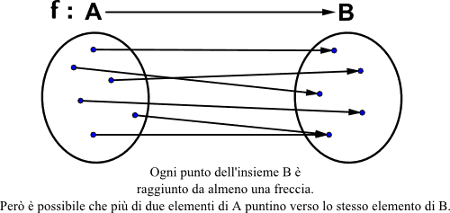
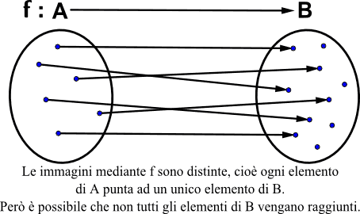

# Relazioni

## Prodotto cartesiano

Immagina di avere due insiemi, **A** e **B**. Il **prodotto cartesiano** (indicato come $A \times B$) è **l'insieme di tutte le possibili coppie ordinate che puoi formare prendendo il primo elemento da A e il secondo da B**. 

In parole povere, è un modo per combinare ogni elemento del primo gruppo con ogni elemento del secondo.

**Un esempio pratico**
Se hai:

- **Insieme A** (gusti gelato): {Cioccolato, Crema}
- **Insieme B** (guarnizioni): {Panna, Granella}

Il prodotto $A \\times B$ sarà l'elenco di tutte le combinazioni possibili:

1. (Cioccolato, Panna)
2. (Cioccolato, Granella)
3. (Crema, Panna)
4. (Crema, Granella)

**Tre cose rapide da sapere:**

1. **L'ordine conta:** La coppia $(x, y)$ è diversa da $(y, x)$. Se inverti gli insiemi ($B \\times A$), le coppie si invertono.
2. **Quanti sono?** Se A ha 3 elementi e B ne ha 4, il prodotto cartesiano ne avrà $3 \\times 4 = 12$.
3. **Graficamente:** Si rappresenta spesso su un piano con due assi (come le coordinate X e Y che usi a scuola), da qui il nome "cartesiano”.

## Relazione Binaria

Sia U un insieme non vuoto.
Una relazione è semplicemente una regola che unisce un elemento del primo insieme A ad un elemento del secondo insieme B.
La relazione viene indicata con la regola R.

**Esempio pratico:**

- Insieme A, ci sono dei bambini: Marco, Giulia e Luca.
- Insieme B, ci sono dei gusti di gelato: Cioccolato e Fragola.
La nostra relazione risponde alla regola "Qual è il gusto preferito?".
- A Marco piace il Cioccolato.
- A Giulia piace la Fragola.
- A Luca piace il Cioccolato.
Ecco, questa è una relazione.

Si scrive:
$\text{(Marco, Cioccolato)}\in R$
$\text{(Giulia, Fragola)} \in R$
$\text{(Luca, Cioccolato)} \in R$
Si legge in modo semplicissimo: "la coppia Marco-Cioccolato fa parte della regola R".
L'insieme di tutte queste relazioni viene detto "Grafico della relazione"

Quindi $R \subseteq U \times U$.
Se R è la nostra relazione, l'insieme è denotato:
${(x,y) : (x,y) \in A \times B \text{ e } R(x,y)}$
Cioè il sottoinsieme di A \times B costituito da tutte le coppie per cui la relazione è verificata.

## Funzione

Una Funzione non è altro che una Relazione un po' più "severa", con delle regole più rigide.
$f$ definita in $A \times B$.

- A è il dominio (elementi di partenza)
- B è il codominio (elementi di arrivo)

La regola principale è che per ogni dominio vi sia uno e uno solo codominio. Non possono esserci più codomini.

Per dire che la nostra regola prende gli elementi dall'insieme A e li manda nell'insieme B, si usa una freccetta: $f:A→B$.
Si scrive così $f(x) = y$.
Si legge semplicemente: "*il valore della funzione per x è uguale a y*". Significa che se diamo x in pasto alla funzione, il risultato è y.

## Funzioni surgettive, iniettive e biiettive

### Funzioni Surgettive (o suriettive)

**Definizione**:
Una funzione $f : A \rightarrow B$ si dice **suriettiva** se ogni elemento $B$ è raggiunto da almeno un elemento di $A$.

**In formule**:  $\exists y \in B, \exists x \in A : f(x) = y$

**Condizione necessaria:**
$|A| \geq |B|$ (serve almeno un elemento di $A$ per ogni elemento di $B$).
Se $|A| \leq |B|$, non si possono coprire tutti gli elementi di $B$.

**Esempio**:

- $A = \{1,2,3,4\}, B = \{x,y,z\}$
- $f(1) = x, f(2) = y, f(3) = z, f(4) = x$
- Ogni elemento di $B (x,y,z)$ è stato raggiunto almeno una volta → **suriettiva**.

**Controesempio**:

- $f(1) = x, f(2) = x, f(3) = x, f(4) = x$
- $y$ e $z$ non sono stati raggiunti → **non suriettiva**.

### Funzioni Iniettive

**Definizione**:
Una funzione $f : A \rightarrow B$ si dice **iniettiva** se elementi diversi di $A$ vanno in elementi diversi di $B$.

**In formule**:  $x_1 \neq x_1 \Rightarrow f(x_1) \neq f(x_2)$

**Condizione necessaria (sulle cardinalità):**
Per avere una funzione iniettiva è necessario che $|A| \leq |B|$.
Se $|A| > |B|$ due elementi di $A$ finiranno sullo stesso elemento di $B$ → **non iniettiva**

**Esempio**:

- $A = \{1,2,3,4\}, B = \{a,b,c,d\}$
- $f(1) = a, f(2) = b, f(3) = c$
- Ogni elemento di $A$ ha una destinazione diversa → **iniettiva**.

**Controesempio**:

- $f(1) = a, f(2) = a, f(3) = b$ → non iniettiva perché $1$ e $2$ vanno entrambi su $a$.

### Funzioni Biiettive

**Definizione**:
Una funzione $f : A \rightarrow B$ si dice **biiettiva** se è **sia surgettiva che iniettiva**.
Equivale a dire che c’è una corrispondenza **uno a uno** tra gli elementi di $A$ e quelli di $B$.

**Condizione necessaria:**
$|A| = |B|$.
(È necessaria ma non sufficiente: anche con la stessa cardinalità, una funzione potrebbe non essere iniettiva o suriettiva.)

**Esempio**:

- $A = \{1,2,3\}, B = \{a,b,c\}$
- $f(1) = a, f(2) = b, f(3) = c$
- Iniettiva (tutti diversi) e suriettiva (ogni elemento di $B$ è raggiunto) → **biiettiva**.

**Controesempio (stessa cardinalità ma non biiettiva)**:

- $A = \{1,2,3\} , B = \{a,b,c\}$
- $f(1) = a, f(2) = a, f(3) = b$
- Non iniettiva (1 e 2 vanno su $a$) e non suriettiva ($c$ non è raggiunto).

## **Riassunto con le condizioni sulle cardinalità**

| **Tipo** | **Condizione necessaria sulle cardinalità** | **Spiegazione** |
| --- | --- | --- |
| **Suriettiva** | $(A \ge B)$ | Servono abbastanza elementi in $A$ per coprire tutti gli elementi di $B$. |
| **Iniettiva** | $( A \le B)$ | Serve spazio in $B$ per mettere ogni elemento di $A$ in un posto diverso. |
| **Biiettiva** | $(A = B)$ | Solo con lo stesso numero si può sperare di avere sia iniettività che suriettività. |

**Importante**: queste condizioni sono **necessarie** ma non **sufficienti**. Per esempio, con $|A| = |B|$ puoi costruire una funzione che non è né iniettiva né suriettiva (come nell’ultimo esempio). La funzione deve essere definita in modo opportuno.

## Cardinalità di un insieme: Teorema e Dimostrazione

### 1. Cardinalità di un insieme

La **cardinalità** di un insieme è, in parole povere, il **numero di elementi che appartengono a quell'insieme**.

- **Il concetto di "contare":** In matematica, contare significa stabilire una **corrispondenza biunivoca** (o biiezione) tra un insieme di oggetti e un insieme "campione" di numeri.
- **Insieme Finito:** Preso l'insieme campione $I_n = \{0, 1, 2, \dots, n - 1\}$ (che contiene i primi interi precedenti a $n$), un insieme $X$ si dice **finito** se è possibile metterlo in corrispondenza biunivoca con $I_n$.
- **Notazione:** Se l'insieme è finito e corrisponde a $I_n$, si dice che ha "numero cardinale $n$" e si scrive matematicamente come $c(X) = n$ oppure $|X| = n$.
- **Insieme Infinito:** Se non esiste nessun numero $n$ per cui si possa creare questa corrispondenza biunivoca, l'insieme $X$ si dice **infinito**.
- **Stessa cardinalità:** Due insiemi hanno lo stesso numero cardinale (cioè $c(X) = c(Y)$) se possono essere messi in corrispondenza biunivoca tra di loro.

### Operazioni con le cardinalità

Se abbiamo due insiemi finiti $X$ e $Y$, possiamo calcolare la cardinalità delle loro operazioni:

- **Unione (Insiemi disgiunti):** Se non hanno elementi in comune, la cardinalità dell'unione è la somma semplice: $c(X \cup Y) = c(X) + c(Y)$.
- **Unione (Caso generale):** Se hanno elementi in comune, bisogna sottrarre l'intersezione per non contare gli elementi due volte: $c(X \cup Y) = c(X) + c(Y) - c(X \cap Y)$.
- **Prodotto Cartesiano:** La cardinalità degli abbinamenti tra i due insiemi è il prodotto delle singole cardinalità: $c(X \times Y) = c(X) * c(Y)$.

### 2. Il Teorema delle Funzioni Iniettive

Questo teorema ci permette di confrontare la grandezza di due insiemi ($A$ e $B$) sapendo che tipo di funzione li collega.

> **Enunciato del Teorema:**
Se $A$ e $B$ sono due insiemi finiti ed esiste una **funzione iniettiva** $f : A \rightarrow B$, allora $|A| \leq |B|$.
> 

*Spiegazione semplice:* Se riesci ad associare ogni elemento di $A$ a un elemento distinto di $B$ senza mai "riciclare" gli arrivi (iniettività), significa necessariamente che in $B$ ci sono abbastanza "posti liberi" per tutti. Quindi gli elementi di $A$ non possono essere più numerosi di quelli di $B$.

### 3. La Dimostrazione del Teorema

Questa è la dimostrazione formale da esporre , suddivisa in passaggi logici:

1. **Analisi dell'Immagine:** Consideriamo l'immagine dell'applicazione, ovvero $f(A)$. Sappiamo per definizione che questo gruppo di elementi "colpiti" si trova dentro l'insieme di arrivo, quindi $f(A) \subseteq B$.
2. **Sfruttiamo l'Iniettività:** Il testo del teorema ci dice che la funzione $f$ è iniettiva. Questo significa che ogni elemento che si trova in $f(A)$ è l'immagine di **uno ed un solo elemento** di partenza nell'insieme $A$.
3. **Confronto delle cardinalità (A e f(A)):** Poiché a ogni elemento di $A$ corrisponde uno e un solo elemento in $f(A)$, possiamo affermare che in $f(A)$ ci sono esattamente tanti elementi quanti ce ne sono in $A$. In formula: $|A| = |f(A)|$.
4. **Conclusione:** Sappiamo che $f(A)$ è un sottoinsieme di $B$ ($f(A) \subseteq B$), per cui il numero dei suoi elementi sarà per forza minore o uguale al totale degli elementi di $B$ (ovvero $|f(A)| \leq |B|$). Sostituendo $|A|$ al posto di $|f(A)|$, arriviamo alla conclusione finale:
$|A| = |f(A)| \leq |B|$.

**C.V.D.** (Come Volevasi Dimostrare).

#### 📌 Riassunto rapido per il ripasso dell'ultimo minuto:

- $|X|$ **o** $c(X)$ = Quanti elementi ci sono in $X$.
- **Contare** = Fare una biiezione (unione uno-a-uno) con un insieme di numeri di riferimento.
- **Teorema:** Se c'è una funzione iniettiva da $A$ a $B \Rightarrow |A| \leq |B|$.
- **Dimostrazione in 3 step:**
    1. L'immagine $f(A)$ è dentro $B$.
    2. Essendo iniettiva, gli elementi in $A$ sono uguali agli elementi in $f(A)$.
    3. Dato che $f(A)$ è più piccolo o uguale a $B$, anche $A$ sarà più piccolo o uguale a $B$.

## Relazioni di equivalenza ($R$) e proprietà

Per capire le classi di equivalenza, dobbiamo prima guardare le tre proprietà che rendono una relazione "di equivalenza". Immagina la relazione come un legame tra due elementi $x$ e $y$.

Ecco le tre proprietà fondamentali: 

1. Riflessiva: Ogni elemento è in relazione con se stesso.
    1. *Esempio: Io sono alto quanto me stesso. (*$xRx$)
2. Simmetrica: Se x è in relazione con y, allora y è in relazione con x. Il legame va in entrambe le direzioni.
    1. *Esempio: Se io sono alto quanto te, tu sei alto quanto me.*  (Se $xRy$, allora $yRx$)
3. Transitiva: Se x è legato ad y, e y è legato a z, allora anche x è legato a z. E’ un effetto a catena.
    1. *Esempio: Se io sono alto quanto te, e tu sei alto quanto Marco, allora io sono alto quanto Marco.*  (Se $xRy$ e $yRz$, allora $xRz$)

Quando queste tre proprietà valgono contemporaneamente, puoi creare le **classi di equivalenza.**

### Relazioni d’ordine e di pre-ordine

In matematica, quando vuoi stabilire chi viene prima e chi dopo, usi le **Relazioni di Ordine**. La differenza sta tutta in una proprietà: la **Simmetria** viene sostituita dall'**Antisimmetria**.

1. Pre-ordine
    
    Una relazione è di pre-ordine se è:
    
    - **Riflessiva**: $x \leq x$ (Ogni elemento è “in riga” con se stesso.)
    - **Transitiva**: Se $x \leq y$ e $y \leq < z$, allora $x \leq z$.
    - Nota: Qui **non c’è antisimmetria**. Due elementi diversi potrebbero “stare prima” l’uno dell’altro senza essere uguali.
2. **Relazione di Ordine**
    
    E’ quella più comune. Per essere tale deve essere:
    
    - **Riflessiva**
    - **Transitiva**
    - **Antisimmetrica**: Se $x \leq y$ e $y \leq x$, allora $x = y$.

Spiegazione delle proprietà anti-simmetrica.

Anti simmetrica se:
xRy e yRx, allora x = y.
Esempio: 
R = minore o uguale (≤)
3 ≤ 5? Si
5 ≤ 3?  No
allora l'unica possibilità è che x = y

esempio
x = 4 e y = 4
4 ≤ 4 ?? si, in ambo i versi

- Preordine: relazione che è riflessiva e transitiva. Non si chiede antisimmetria. Quindi può succedere che due elementi diversi siano in relazione in entrambi i sensi.
    
    Esempio 1 (preordine, non antisimmetrico)
    Prendiamo l’insieme delle persone e la relazione “non è più alto di” (cioè “è alto al massimo quanto”).
    È riflessiva: ogni persona è alta al massimo quanto se stessa.
    È transitiva: se A non è più alto di B, e B non è più alto di C, allora A non è più alto di C.
    Non è antisimmetrica: se Marco e Lucia hanno la stessa altezza, allora Marco non è più alto di Lucia (sono uguali) e Lucia non è più alta di Marco.
    Quindi due persone diverse sono in relazione in entrambi i versi.
    Questo è un preordine.
    
- Ordine: relazione che è riflessiva, transitiva e antisimmetrica.
Quindi due elementi diversi non possono mai essere in relazione in entrambi i sensi.
    
    Esempio 2 (ordine, antisimmetrico)
    Prendiamo i numeri interi con la relazione ≤.
    È riflessiva, transitiva, ed è antisimmetrica: se x≤y e y≤x, allora x=y.
    Questo è un ordine.
    

### Insiemi ordinati e pre-ordinati

<aside>
💡

- Un insieme U su cui è definita un relazione di pre-ordine si dice pre-ordinato.
- Un insieme U su cui è definita un relazione d’ordine si dice ordinato.
</aside>

- **Insieme Pre-ordinato**: È un insieme dove hai stabilito una regola di **pre-ordine** (quella con le proprietà Riflessiva e Transitiva). È un insieme "abbozzato", dove puoi dire chi viene prima di chi, ma potresti avere elementi diversi che si scambiano il posto.
- **Insieme Ordinato**: È un insieme dove la regola è di **ordine** (quindi ha anche l'Antisimmetrica). Qui la gerarchia è solida: se $x$ precede $y$ e $y$ precede $x$, allora sono lo stesso elemento ($x = y$). Non ci sono ambiguità.
- **La distinzione tra $\leq$ e $\lt$:**
    
    **(Relazione larga $\le$)**: Include la possibilità che i due elementi siano uguali. "X viene prima o è uguale a Y".
    
    **(Relazione stretta $\lt$)**: Si ottiene prendendo la relazione larga e togliendo il caso in cui siano uguali. "X viene decisamente prima di Y"
    

In sintesi: La slide dice che un insieme "prende il nome" dalla relazione che lo governa. Se la relazione è un ordine, l'insieme diventa un Insieme Ordinato.

### Relazioni e Partizioni

La differenza tra Relazione di Equivalenza e Classe di Equivalenza.

- **La Relazione di Equivalenza (R)**
    
    E’ la regola o il “criterio” che si decide per confrontare gli elementi.
    
    - Esempio: “Avere lo stesso colore”
    - Per essere una relazione di equivalenza, questa regola deve essere: riflessiva, simmetrica e transitiva. Senza nessuna di queste caratteristiche puoi creare i gruppi.
- **La Classe di Equivalenza ([x])**
    
    E’ il risultato dell’applicazione di quella regola. Sono i “gruppi” (o le classi) dove metti dentro tutti gli elementi che si somigliano secondo la regola.
    
    - Esempio: “Il gruppo di tutti gli oggetti Rossi”.
    - La classe non “possiede” la proprietà riflessiva/simmetrica/transitiva; la classe **esiste grazie al fatto** che la relazione le possiede.

### 1. La Partizione

Una **partizione** di un insieme $U$ è una suddivisione in sottoinsiemi (chiamati **classi**) che rispetta tre condizioni:

1. **Non vuote:** Ogni classe deve contenere almeno un elemento.
2. **Disgiunte:** Le classi non hanno elementi in comune (un elemento sta in una sola classe).
3. **Esaustive:** L'unione di tutte le classi restituisce l'insieme $U$ originale.

### 2. Relazione di Equivalenza ($\mathcal{R}$)

Ogni **relazione di equivalenza** definita su un insieme $U$ genera sempre una partizione.
Gli elementi che soddisfano la relazione finiscono nella stessa "scatola", chiamata **Classe di Equivalenza**.

**Esempio Numerico:**
Insieme $U = \{1, 2, 3, 4, 5, 6\}$

Regola $\mathcal{R}$: *"Avere lo stesso resto nella divisione per 2"* (Pari o Dispari).

- **Classe A (Dispari):** $\{1, 3, 5\}$
- **Classe B (Pari):** $\{2, 4, 6\}$

### 3. Insieme Quoziente ($U/\mathcal{R}$)

L'**Insieme Quoziente** è l'insieme che ha come elementi le classi stesse (i gruppi), non i singoli numeri.

- **Simbolo:** $U/\mathcal{R}$ (si legge "U modulo $\mathcal{R}$").
- **Esempio:** $U/\mathcal{R} = \{ \{1, 3, 5\}, \{2, 4, 6\} \}$.

**In sintesi:**

- **Elementi di** $U$**:** I singoli numeri ($1, 2, 3...$).
- **Classi:** I raggruppamenti (Dispari, Pari).
- **Insieme Quoziente:** Il "contenitore" di tutti i raggruppamenti.

### Relazioni di Equivalenza e Applicazioni Surgettive

### 1. Dalla Partizione alla Relazione (Il lavoro del postino "al contrario")

Se trovi dei sacchi già pieni e divisi (**Partizione** $\mathcal{F}$), puoi risalire all'unica regola (**Relazione** $\mathcal{R}$) che è stata usata per riempirli.

- **Regola:** Due lettere $x, y$ sono in relazione ($x \approx y$) se e solo se si trovano nello stesso sacco.
- **Risultato:** $\mathcal{F} = U/\mathcal{R}$ (La divisione dei sacchi coincide con l'Insieme Quoziente).

### 2. L'Applicazione Canonica sul Quoziente (Il gesto di smistare)

Data una regola $\mathcal{R}$, definiamo il "gesto" del postino di mettere ogni lettera nel suo sacco:

$$
\pi: U \to U/\mathcal{R}
$$

- **Azione:** Prendi la lettera $x$ e lanciala nella sua classe di equivalenza $[x]$.
- **Definizione:** Questa funzione è chiamata **Applicazione Canonica**.

### 3. Perché è sempre Surgettiva?

L'applicazione è **surgettiva** perché, per definizione di partizione, non esistono classi vuote.

- **In pratica:** Se esiste un sacco postale nell'Insieme Quoziente, significa che c'è almeno una lettera indirizzata a quella città.
- **Conclusione:** Ogni "sacco" (classe) viene riempito da almeno un "elemento" (lettera) di $U$. Non rimangono sacchi vuoti a fine lavoro.

### Esempio Rapido

- **Insieme** $U$**:** 3 lettere per Napoli, 2 per Venezia.
- **Insieme Quoziente** $U/\mathcal{R}$**:** {Sacco Napoli, Sacco Venezia}.
- **Applicazione:** Tutte le 5 lettere vengono smistate.
- **Esito:** Tutti i sacchi sono pieni $\rightarrow$ L'applicazione è **Surgettiva**

---

### Classi di equivalenza e partizioni

Data una relazione di equivalenza, avremo una partizione del gruppo di oggetti in gruppi separati ed ordinati.

Prendiamo una **classe di equivalenza** ($[x]_2$): Immaginiamo di avere un insieme Z, $[x]_2$ sarà la parte di insieme che comprende i numeri pari; mentre $[x]_2+1$ sarà la parte di insieme che comprende i numeri dispari. Così avremo una partizione dell’insieme in due classi di equivalenza: pari e dispari.

**L’insieme quoziente ($U/R$)**. E’ semplicemente l’insieme di tutti questi gruppi (le classi di equivalenza) cioè il nostro insieme completo.

Per rispettare il concetto di “Partizione” queste classi devono rispettare **3 regole** ferree:

1. **Nessuna classe deve essere vuota.**
2. **Coprono tutto (U)**. Ogni elemento deve avere la sua classe di equivalenza, non deve rimanerne nemmeno uno isolato.
3. **Niente sovrapposizioni.** Nessun elemento può stare in più classi di equivalenza contemporaneamente.

**In sintesi:** Una relazione di equivalenza "affetta" il tuo insieme originale in pezzi distinti che, se rimessi insieme, lo ricostruiscono perfettamente.

## Massimi e Minimi | Minimale e Massimale

### Minimo e Massimo

Prendiamo un insieme U con la relazione d'ordine minore o uguale $\leq$.

- Il Massimo M di U è l'elemento tale che per ogni $x \in U$  e si ha $x \leq M$.
In pratica, M è "l'elemento più grande o uguale di tutti gli altri presenti in U".
Se esiste, è l'unico (per l'antisimmetria).
- Il Minimo di U è l'elemento tale che per ogni $x \in U$ e si ha $m \leq x$.In pratica, m è l'elemento più piccolo o uguale di tutti gli altri presenti in U.
Se esiste, è l'unico.

Esempi.

1. Prendiamo l'insieme dei numeri naturali $\mathbb{N} = \{0,1,2\}$ con il solito $\leq$:
    
    Minimo = 0 (è il più piccolo di tutti)
    
    Massimo = non esiste nei numeri naturali perché, essendo l'insieme infinito e privo di un "ultimo" elemento, per ogni numero scelto ne esisterà sempre uno successivo $(n+1)$ che lo supera.
    
2. Nell’insieme ${2,3,5}$ con $\leq$:
    
    Minimo = 2  Massimo = 5
    

### Minimale e Massimale

---

## Insiemi Ordinati (Massimo, Minimo, Massimali, Minimali

Sia $(S, \le)$ un insieme parzialmente ordinato.

### Definizioni Fondamentali

- **MASSIMO**: È unico. Ogni singolo elemento dell'insieme deve essere minore o uguale a lui ($\forall x \in S, x \le M$).
- **MINIMO**: È uno solo. Ogni singolo elemento dell'insieme deve essere maggiore o uguale a lui ($\forall x \in S, m \le x$).
- **MASSIMALE**: Ce ne possono essere molti, uno solo o nessuno. Un elemento è massimale se "non esiste nessuno più grande di lui" nell'insieme.
- **MINIMALE**: Ce ne possono essere molti, uno solo o nessuno. Un elemento è minimale se "non esiste nessuno più piccolo di lui" nell'insieme.

### Regole d'Oro per gli Esercizi

1. **Se hai più di un Massimale** $\implies$ Il Massimo **NON esiste mai**.
2. **Se hai più di un Minimale** $\implies$ Il Minimo **NON esiste mai**.
3. **Unicità**: Se il Massimo esiste, è l'unico massimale. Se il Minimo esiste, è l'unico minimale.

### Esempio 1: Relazione di Inclusione ($\subseteq$)

**Insieme**: $S = \{ \{a\}, \{b\}, \{c\}, \{a,b\}, \{a,c\}, \{b,c\} \}$

- **Minimali**: $\{a\}, \{b\}, \{c\}$ (Nessun elemento di $S$ è contenuto in loro).
- **Massimali**: $\{a,b\}, \{a,c\}, \{b,c\}$ (Non sono contenuti in nessun altro elemento di $S$).
- **Minimo**: **NON ESISTE** (Ci sono più minimali e sono inconfrontabili).
- **Massimo**: **NON ESISTE** (Ci sono più massimali e sono inconfrontabili).

### Esempio 2: Relazione di Divisibilità ($|$)

**Insieme**: $S = \{2, 4, 5, 8, 10, 20\}$
**Regola**: $x \le y \iff x \text{ divide } y$

**Analisi delle relazioni:**

- $2 \mid 4, 8, 10, 20$
- $4 \mid 8, 20$
- $5 \mid 10, 20$
- $10 \mid 20$
- $8$ e $20$ non dividono nessuno (oltre a se stessi).

**Minimali**: Quali numeri non hanno nessuno che li divide ? 2 e 5
**Massimali**: Quali numeri non dividono nessun altro? 8 e 20
**Minimo**: Esiste un numero solo che divide tutti gli altri? no
**Massimo**: Esiste un numero solo che è diviso da tutti gli altri? no

**Risultati:**

- **Minimali**: $\{2, 5\}$ (Sono i numeri che non hanno nessuno che li divide nell'insieme).
- **Massimali**: $\{8, 20\}$ (Sono i numeri che non dividono nessun altro nell'insieme).
- **Minimo**: **NON ESISTE** (Il $2$ non divide il $5$, quindi non divide "tutti" gli altri).
- **Massimo**: **NON ESISTE** (Il $20$ non è diviso dall'$8$, quindi non è diviso da "tutti" gli altri).

## Insiemi totalmente ordinati

Finora abbiamo parlato di **ordine parziale**: una relazione che è riflessiva, antisimmetrica e transitiva, ma non è detto che due elementi qualsiasi siano confrontabili.

Esempio: nell’insieme delle parti, $\{a\}$ e $\{b\}$ non sono confrontabili (nessuno dei due è sottoinsieme dell’altro).

Un **ordine totale** (o lineare) è un ordine in cui ogni coppia di elementi è confrontabile. Cioè, per ogni $x, y$, nell’insieme, si ha $x \leq y$ oppure $y \leq x$.

Esempi di insiemi che sono totalmente ordinati:

- Numeri naturali, interi, razionali, reali con $\leq$ sono insiemi totalmente ordinati.
- Parole in ordine alfabetico (dizionario) è un ordine totale
- Insieme delle parti con $\subseteq$ non totale.

Si chiama totale perché copre “tutte” le coppie, non ci sono coppie incomparabili.

**Esempio concreto**

Prendi l’insieme {2,4,8,16} con l’ordine “divide”.
È un ordine totale?
2 divide 4, 8, 16
4 divide 8, 16
8 divide 16

Ogni coppia è confrontabile (perché ogni numero è potenza di 2). Quindi sì, è totale.

Prendi invece {2,3,6} con “divide”.
2 e 3 non sono confrontabili (2 non divide 3, 3 non divide 2). Quindi non è totale.

## Strutture dati per insiemi di interi

Supponiamo di avere un insieme finito di numeri interi, per esempio $A = \{3,5,7,10\}$
Vogliamo scegliere un modo per rappresentarlo che ci permetta di fare operazioni in modo efficiente.

1. Rappresentazione binaria (vettore di bit)

Prendiamo un insieme universo $U$ che contiene tutti i numeri che ci possono interessare.
Di solito $U = I_m = \{0,1,2, \cdots, m-1\}$  per qualche $m$.

Costruiamo un array di bit (o di booleani) di lunghezza $m$, dove la posizione $i$ vale $1$ se $i \in A$, $0$ altrimenti.

Esempio:
$U = \{0,1,2,3,4,5,6,7,8,9\}$ (cioè m = 10)
$A = \{3,5,7\}$

Quindi avremo $U = \{0,0,0,1,0,1,0,1,0,0\},$ in corrispondenza di dove avevamo $3, 5$ e $7$

**Vantaggi**:

- Verificare se un numero appartiene all’insieme è **immediato**: guardo la posizione corrispondente e vedo se c’è 1 o 0. Tempo costante.
- Calcolare unione e intersezione è veloce: basta fare **OR** e **AND** bit a bit.

**Svantaggi**:

- Se l’universo U*U* è grande (per esempio m=1.000.000*m*=1.000.000) ma l’insieme A*A* ha pochi elementi, sprechiamo memoria (dobbiamo tenere un array di 1.000.000 di bit anche se l’insieme è piccolo).
1. Rappresentazione estesa (lista o array degli elementi)

Nella **rappresentazione estesa**, l’insieme viene semplicemente scritto come un elenco (di solito tra parentesi quadre, come un array) contenente solo gli elementi che ci appartengono.

- In matematica scriviamo A={3,5,7} con le parentesi graffe.
- Nella rappresentazione estesa (informatica) lo scriviamo come lista: `[3, 5, 7]`.

L’idea è che non usiamo una tabella di bit per tutti i numeri possibili, ma teniamo solo gli elementi presenti. Quindi sì, è proprio l’insieme scritto “per esteso”.

## Hitting Set

#### **1. Definizione Formale**

Dati:

- Un **insieme universo** $U = \{1, 2, 3, \dots, n\}$ (gli elementi che puoi scegliere).
- Una **collezione di sottoinsiemi** $S = \{S_1, S_2, \dots, S_m\}$ dove ogni $S_i$ contiene elementi di $U$.

Un **Hitting Set** è un sottoinsieme $H \subseteq U$ tale che $H$ ha almeno un elemento in comune con ogni sottoinsieme della collezione $S$.
In formule: $\forall S_i \in S, H \cap S_i \neq \emptyset$.

#### **2. Minimale vs. Minimo**

Esiste una distinzione cruciale tra questi due termini:

- **Hitting Set Minimale:** È un insieme che colpisce tutti i gruppi, ma se provi a togliere anche un solo elemento, smette di essere un hitting set. Non è necessariamente il più piccolo in assoluto, è solo "non ulteriormente riducibile".
- **Hitting Set Minimo:** È l'insieme con la **cardinalità più bassa possibile** (quello con meno elementi in assoluto) tra tutti i possibili hitting set. Trovare questo insieme è un problema **NP-difficile**, ovvero non esiste un algoritmo veloce (polinomiale) per risolverlo esattamente su larga scala.

#### **3. L'Algoritmo Greedy (Ingordo)**

Poiché trovare la soluzione perfetta (il minimo) è difficile, si usa spesso l'approccio **Greedy**, che è veloce e offre una buona approssimazione: [1]

1. Inizia con un insieme $H$ vuoto.
2. Finché ci sono sottoinsiemi in $S$ che non sono stati ancora "colpiti":
    - Conta quante volte ogni elemento di $U$ compare nei sottoinsiemi non ancora colpiti.
    - Scegli l'elemento che compare **più spesso**.
    - Aggiungi quell'elemento ad $H$.
    - Segna come "colpiti" tutti i sottoinsiemi che contengono quell'elemento.
3. Quando tutti i sottoinsiemi sono colpiti, restituisci $H$.

**Nota:** L'algoritmo greedy non garantisce sempre la soluzione minima, ma garantisce di non allontanarsi troppo da essa (il fattore di approssimazione è logaritmico rispetto alla dimensione degli insiemi).

#### **Esempio Pratico**

Immagina di avere tre gruppi di amici che vogliono ordinare una pizza:

- Gruppo A: {Margherita, Diavola}
- Gruppo B: {Diavola, Funghi}
- Gruppo C: {Margherita, Funghi, Vegetariana}

L'**Hitting Set Minimo** è {Diavola, Margherita} (o altre coppie), perché con solo 2 pizze accontenti tutti i gruppi. Un hitting set non minimale sarebbe {Diavola, Margherita, Funghi}: colpisce tutti, ma potresti togliere la Funghi e funzionerebbe ancora.