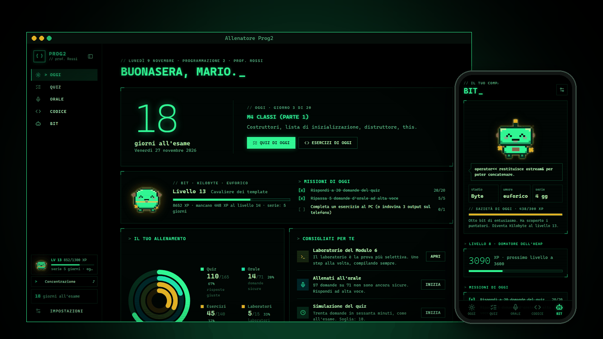
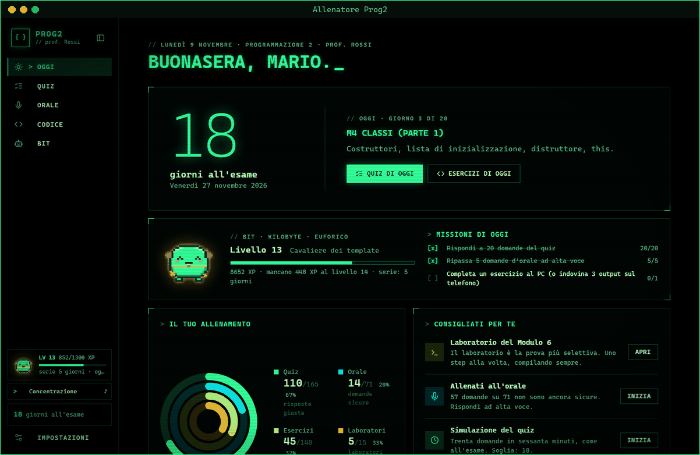
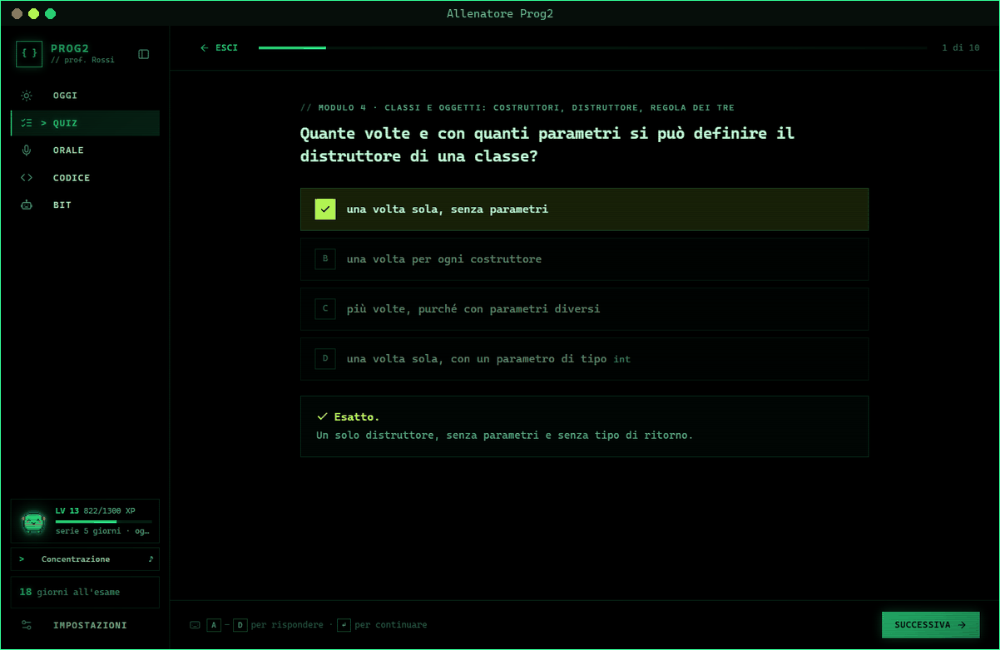
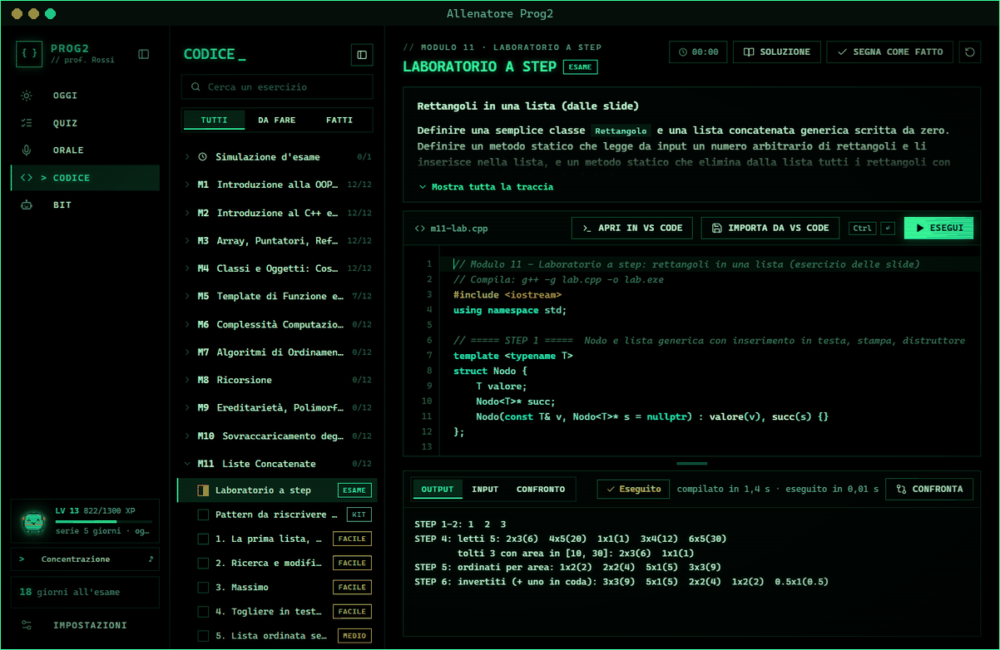
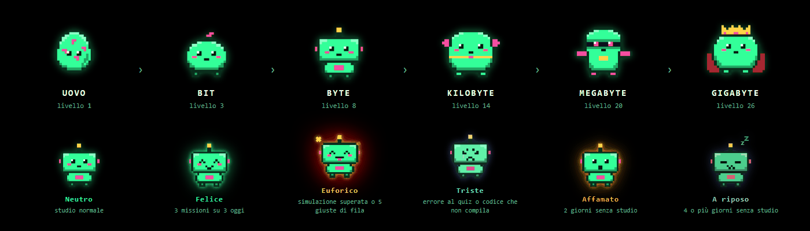
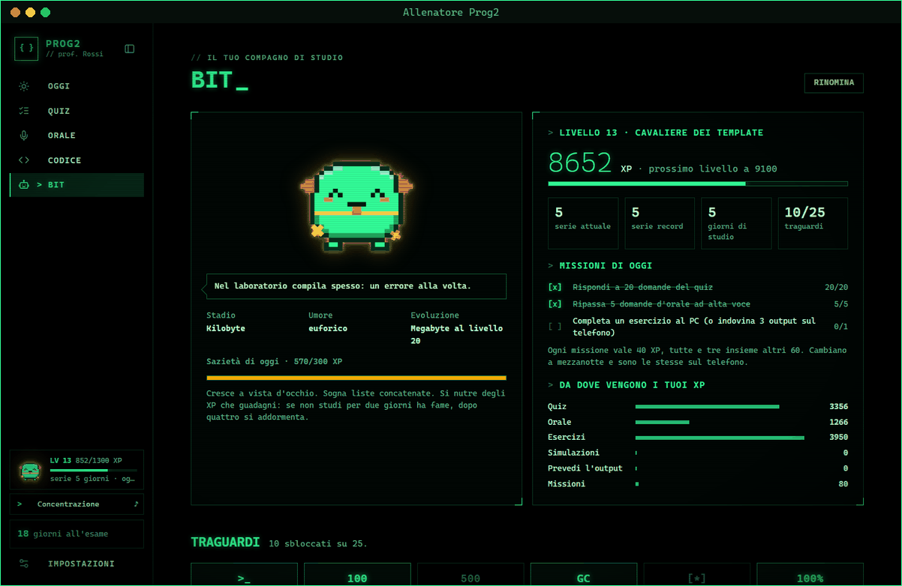
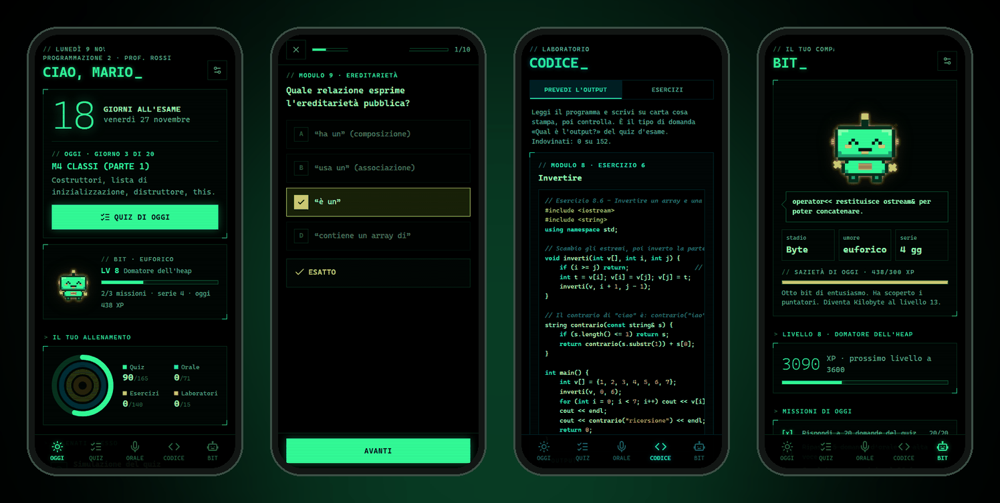
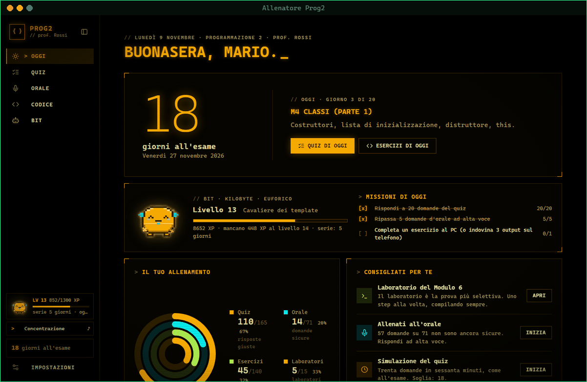
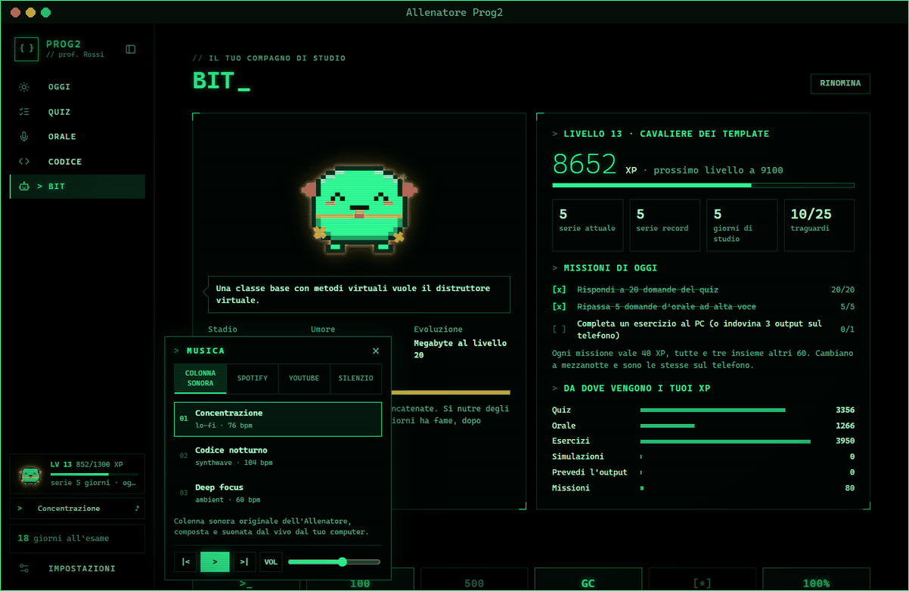
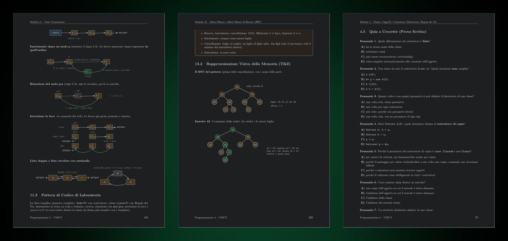

<p align="center">
  
</p>

<h1 align="center">Dispensa &amp; Allenatore Prog2</h1>

<p align="center">
  <b>Tutto quello che serve per superare Programmazione 2 all'Università di Catania.</b><br>
  Una dispensa da 295 pagine che spiega, un'app che ti allena, un compagno che cresce con te.
</p>

<p align="center">
  <a href="https://github.com/KurtSixxxx/MyUniversity/releases"></a>
  <a href="https://github.com/KurtSixxxx/MyUniversity/releases"></a>
  <a href="https://kurtsixxxx.github.io/MyUniversity/"></a>
  <a href="Dispensa/dispensa-dark.pdf"></a>
</p>

<p align="center">
  
  
  
  
  
  
</p>

---

## L'esame in tre prove, il kit in tre pezzi

L'esame ha un **quiz a crocette** a sbarramento, una **prova di laboratorio** al PC e un **orale**. Leggere non basta: bisogna allenarsi su tutte e tre. Il kit è fatto apposta.

| | Cosa fa | Per quale prova |
|:--|:--|:--|
| 📘 **La dispensa** | 14 moduli, dalle classi ai grafi. Teoria con analogie, disegni della memoria, codice commentato, trappole d'esame. Volume separato con tutte le soluzioni. | tutte |
| 💻 **L'Allenatore per PC** | Quiz con simulazione d'esame cronometrata, orale a flashcard, editor C++ che compila con `g++ -Wall -Wextra` come in laboratorio e confronta il tuo output con la soluzione. | quiz · laboratorio · orale |
| 📱 **L'Allenatore sul telefono** | Quiz, orale e «Prevedi l'output» nei tempi morti. Android e iPhone, si installa dal browser, funziona offline. | quiz · orale |

E sopra tutto **Bit**, il compagno di studio che si nutre dei tuoi XP.

---

## Una giornata con l'Allenatore

<p align="center"></p>

**Oggi** ti dice quanti giorni mancano all'appello, cosa studiare secondo il piano, le tre missioni del giorno e dove stai sbagliando. Niente da decidere: apri e inizi.

<table>
<tr>
<td width="50%"></td>
<td width="50%"></td>
</tr>
<tr>
<td><b>Quiz a crocette.</b> Allenamento con correzione immediata (le domande sbagliate tornano più spesso) oppure simulazione d'esame: 30 domande, 60 minuti, soglia 18. Si risponde anche da tastiera.</td>
<td><b>Codice.</b> Pattern da riscrivere a memoria, laboratorio a step e 10 esercizi per modulo. <code>Ctrl+Invio</code> compila ed esegue, gli errori sono segnati riga per riga, <i>Confronta</i> mette il tuo output accanto a quello della soluzione. Anche in VS Code.</td>
</tr>
</table>

**Orale.** Le domande della dispensa come flashcard: rispondi ad alta voce con il cronometro, poi guardi la risposta modello e ti valuti. Quelle che non sai tornano più spesso (ripetizione distanziata).

---

## Bit, il tuo compagno di studio

<p align="center"></p>

Bit nasce da un uovo e si evolve con il tuo livello: **Uovo (1) → Bit (3) → Byte (8) → Kilobyte (14) → Megabyte (20) → Gigabyte (26)**, ogni volta con una forma nuova e un lampo di evoluzione. Fino a Kilobyte è un cucciolo entusiasta; da Megabyte diventa un *Senior Dev* teatrale, drammatico con i memory leak e snob con le domande facili.

Ha **sei umori**, legati a quello che fai davvero: *neutro* mentre studi, *felice* quando completi le tre missioni del giorno, *euforico* se superi una simulazione (o fai cinque giuste di fila), *triste* dopo un errore o una compilazione fallita, *affamato* dopo due giorni senza studio, *a riposo* dopo quattro.

**Bit è sempre in scena**, in punti fissi come un commentatore: sopra la domanda nei quiz, accanto all'output di `g++` nel codice, a lato della carta all'orale. Mangia gli XP delle risposte giuste, va in glitch con gli errori, fa il giro della vittoria con i coriandoli e parla con un fumetto a 8 bit.

**L'armadio di Bit**: con i traguardi sblocchi palette (Ambra vintage, Ciano hacker, Cyberpunk magenta, GameBoy, Oro leggendario), accessori (occhiali *Thug Life*, cappello da laurea, monocolo, cuffie lo-fi, sciarpa C++, baffetto) ed espressioni (`^_^` `¬_¬` `ಠ_ಠ` `*_*`).

<table>
<tr>
<td width="55%"></td>
<td>

- ⚡ **XP** per ogni risposta, esercizio, laboratorio e simulazione
- 🏆 **Livelli** con titoli, da *Hello World* a *Leggenda di Prog2*
- 🎯 **3 missioni al giorno**, uguali su PC e telefono
- 🔥 **Serie** di giorni di studio consecutivi
- 🏅 **25 traguardi** da sbloccare

I punti sono calcolati dai progressi veri: non si «farmano» ripetendo la stessa domanda.

</td>
</tr>
</table>

---

## Sul telefono, in tasca

<p align="center"></p>

Apri **[kurtsixxxx.github.io/MyUniversity](https://kurtsixxxx.github.io/MyUniversity/)** e installala:

- **iPhone**: Safari → Condividi → *Aggiungi alla schermata Home*
- **Android**: Chrome → ⋮ → *Installa app*

Funziona offline. PC e telefono si sincronizzano con un codice da copiare e incollare: nessun account, nessun server, i tuoi dati restano tuoi.

---

## Fallo tuo

<table>
<tr>
<td width="50%"></td>
<td width="50%"></td>
</tr>
<tr>
<td><b>Colori e profilo.</b> Il terminale verde fosforo diventa ambra, ciano, magenta o il colore che vuoi. Nome, data dell'appello, docente, corso e nome del compagno.</td>
<td><b>Musica per studiare.</b> Una colonna sonora originale (lo-fi, synthwave, ambient) generata dal vivo, oppure la tua playlist <b>Spotify</b> o <b>YouTube</b>. <code>Ctrl+M</code> per il silenzio.</td>
</tr>
</table>

---

## La dispensa

<p align="center"></p>

Ogni modulo ha sempre le stesse otto sezioni: **teoria e analogie**, **disegni della memoria**, **pattern di codice**, **trappole d'esame**, **quiz**, **laboratorio a step in stile esame**, **domande d'orale con risposta modello**, **10 esercizi al PC**. Tutto il codice è compilato ed eseguito davvero, e l'output stampato è quello reale. Nel codice di laboratorio la STL non si usa: liste, pile, code, alberi e grafi sono scritti da zero con `new` e `delete`, come all'esame.

In appendice: piano di studio, **simulazione d'esame completa**, formulario, glossario e strategie per le tre prove.

| Modulo | | Modulo | |
|:--|:--|:--|:--|
| 1 | OOP e information hiding | 8 | Ricorsione |
| 2 | C++: I/O, namespace, scope | 9 | Ereditarietà, polimorfismo, RTTI |
| 3 | Puntatori, reference, stack e heap | 10 | Overloading degli operatori |
| 4 | Classi, costruttori, Regola dei Tre | 11 | Liste concatenate |
| 5 | Template | 12 | Pile e code |
| 6 | Complessità computazionale | 13 | Alberi e BST |
| 7 | Ordinamento e ricerca | 14 | Grafi, BFS e DFS |

📄 [Dispensa (scura)](Dispensa/dispensa-dark.pdf) · [Dispensa (da stampare)](Dispensa/dispensa-light.pdf) · [Soluzioni (scure)](Dispensa/soluzioni-dark.pdf) · [Soluzioni (da stampare)](Dispensa/soluzioni-light.pdf)

---

## Inizia in 3 minuti

**Windows**

1. **Scarica** la dispensa e [`Allenatore Prog2.exe`](https://github.com/KurtSixxxx/MyUniversity/releases); metti l'exe accanto alla cartella `Dispensa`.
2. **Installa g++** con [MSYS2](https://www.msys2.org): `pacman -S mingw-w64-ucrt-x86_64-gcc`, poi aggiungi `C:\msys64\ucrt64\bin` al `Path`.
3. **Avvia** l'Allenatore: nome, appello, colore, nome del compagno. Fatto.

**Mac**

1. **Scarica** dalle [Release](https://github.com/KurtSixxxx/MyUniversity/releases) il `.dmg` giusto: `AppleSilicon` per i Mac con chip M1, M2, M3, M4…, `Intel` per quelli più vecchi (menu Apple → *Informazioni su questo Mac*). Aprilo e trascina l'app in *Applicazioni*.
2. **Installa il compilatore**: nel Terminale scrivi `xcode-select --install` e conferma.
3. **Avvia** l'Allenatore. La prima volta macOS potrebbe bloccarla (non è firmata da Apple): *Impostazioni di Sistema → Privacy e sicurezza → Apri comunque*.

La guida completa (installazione, uso insieme alla dispensa, telefono, sincronizzazione, problemi frequenti) è il capitolo **«Prima di iniziare»** della dispensa.

<details>
<summary><b>Domande frequenti</b></summary>

- **Windows dice «Windows ha protetto il PC».** È normale per i programmi non firmati: *Ulteriori informazioni → Esegui comunque*.
- **«Non trovo il compilatore g++».** Controlla il `Path` e riavvia l'app (il `Path` si legge solo all'avvio).
- **Spotify suona solo 30 secondi.** Premi *Accedi a Spotify* nel lettore e accedi con email e password.
- **Il Mac dice che l'app «non può essere aperta» o è «danneggiata».** L'app non è firmata da Apple: *Impostazioni di Sistema → Privacy e sicurezza → Apri comunque*, oppure nel Terminale `xattr -dr com.apple.quarantine "/Applications/Allenatore Prog2.app"`. Sul Mac le scorciatoie con Ctrl funzionano anche con ⌘.
- **Uso Linux.** La versione per telefono funziona in qualunque browser; l'app per PC parte anche dai sorgenti con `python app.py` (serve `pip install pywebview`).
- **Dove sono i miei progressi?** Su Windows in `%APPDATA%\Allenatore Prog2`, sul Mac in `~/Library/Application Support/Allenatore Prog2`, sul telefono nella memoria del browser. Il codice `P2:` è anche un backup.

</details>

---

## Contribuire

Hai trovato un errore, una domanda ambigua o un esercizio che non compila? Apri una *issue* o una *pull request*.

- **Dispensa**: sorgenti LaTeX in `Dispensa/`. Il codice in `Dispensa/codice/` si verifica con `bash verifica_codice.sh mNN`; i PDF si ricompilano con `compila.bat`.
- **App**: sorgenti in `Allenatore/` (Python + pywebview, interfaccia HTML/CSS/JS). `pip install -r requirements.txt`, poi `python app.py`.
- Quiz, domande d'orale ed esercizi dell'app sono **letti direttamente dalla dispensa**: per aggiungerne uno basta scriverlo nel modulo.

```
Dispensa/      sorgenti LaTeX, PDF e codice/ (mNN/: pattern, lab, es01..es10, input, output)
Allenatore/    sorgenti dell'app per PC e del generatore della versione per telefono
docs/          versione per telefono, pubblicata su GitHub Pages
```

---

<p align="center">
  Un progetto di <b>Giulio Casella</b>, realizzato con l'aiuto di Claude (Anthropic).<br>
  Licenza <a href="https://creativecommons.org/licenses/by-nc-sa/4.0/deed.it">CC BY-NC-SA 4.0</a> · materiale non ufficiale, scritto da studenti per studenti: in caso di dubbio valgono le indicazioni del docente.
</p>
