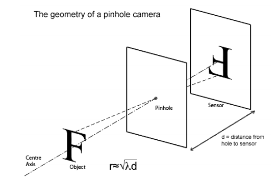

# Untitled

Come vediamo? L’occhio è una fotocamera avanzata
Nell’occhio, la luce entra, viene messa a fuoco da una lente (il cristallino) e viene infine proiettata su un sensore (la retina)

La luce entra nel “pinhole” e sulla parete opposta si forma l’immagine capovolta:

I raggi vanno dal basso verso l’alto e dall’alto verso il basso

Nel pinhole:

- Per avere una immagine nitida serve un foro piccolo ma l’immagine è quasi un punto
- Se invece abbiamo un foro grande entra tanta luce e l’immagine appare come una macchia sfocata. Questo fa riferimento al fenomeno di diffrazione.

Per risolvere il problema della legge di sovrapposizione si fa riferimento alla lente sottile

1. Un apertura grande raccoglie la luce
2. Tramite rifrazione fa coincidere tutti i punti in un unico punto nitido detto fuoco

Quindi piega tutti raggi e li fa coincidere in un unico punto

$$
\frac{1}{u} + \frac{1}{v} = \frac{1}{f}
$$

U è la distanza tra la lente e l’oggetto

v è la distanza tra la l ente e il punto dove si forma l’immagine

f è la lunghezza focale